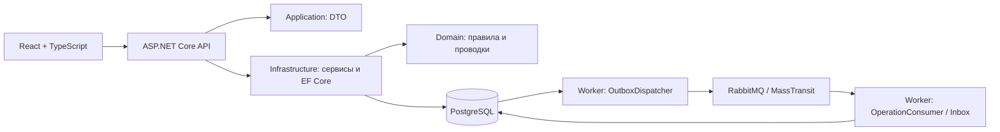
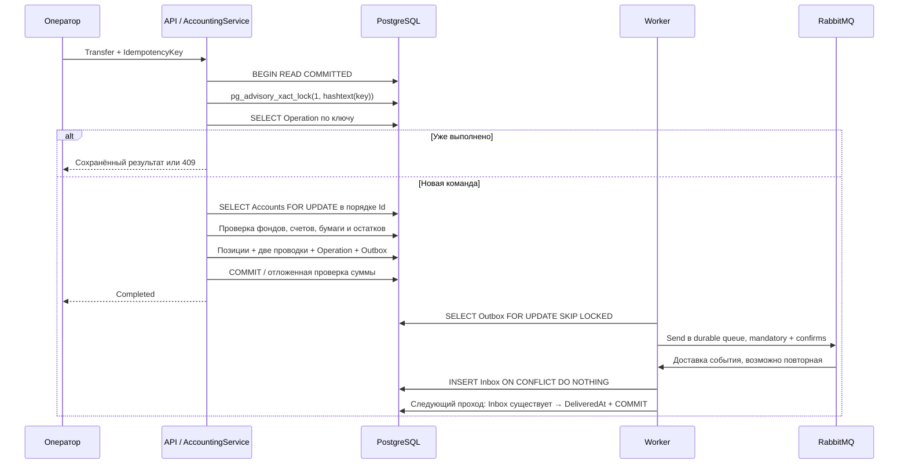

# Архитектура

Модульный монолит имеет одну схему и один источник истины. Worker — способ вынести длительную доставку из HTTP-процесса; отдельной бизнес-БД или собственного учёта у него нет. Domain и Contracts не зависят от инфраструктуры. Application содержит контракты команд, а обработчики расположены в Infrastructure, поскольку координируют реальные PostgreSQL-блокировки. Отдельный MediatR/repository слой не добавлен.

## Перевод

## Транзакционные границы и конкурентность

Один HTTP-запрос получает scoped DbContext. В одной транзакции фиксируются результат команды, версии и количества позиций, журнал и событие. Нет сетевой отправки сообщения до фиксации учёта. При ошибке транзакция откатывается полностью. Неудачные операции не пишутся как фиктивно Completed; диагностические события остаются в журнале приложения.

Сначала advisory lock глобального ключа команды, затем строковые блокировки счетов в отсортированном порядке UUID. Коллизия хеша лишь увеличит ожидание, а не нарушит уникальность. Счёт выбран вместо Position, чтобы защищать ещё не существующие строки. Два независимых счёта могут изменяться параллельно, но разные бумаги одного счёта сериализуются. После ожидания PostgreSQL READ COMMITTED читает уже обновлённые остатки. Version дополнительно помечен EF concurrency token. При двух списаниях 80 из 100 второй видит 20 и получает 422.

Для корректировки добавляется advisory lock исходной операции в namespace 2; ключи команд используют namespace 1, session-lock DemoSeed — namespace 3. Пользовательский ключ вида reverse:{id} не может захватить блокировку оригинала. Для корректировки используется только одна блокировка оригинала, уникальная nullable ссылка защищает от повторной корректировки также на уровне БД. Порядок блокировок счётов одинаков для переводов и корректировок. Публичного редактирования справочников в MVP нет; если появится изменение статуса одновременно с проводкой, потребуется согласовать его с теми же блокировками.

CHECK ограничения защищают положительные котировки/паи и неотрицательные позиции, внешние реквизиты и состояния. FK используют ограничения ссылочной целостности. SQL-trigger запрещает UPDATE/DELETE проводок. Отложенные triggers на Operations и Entries проверяют Transfer на COMMIT: ровно две ненулевые противоположные проводки, разные счета, одна бумага и совпадение фондов счетов с фондом операции. Проверяется также операция без проводок. Пользователь БД с правами владельца теоретически может отключить триггеры — эксплуатационное разделение прав ещё требуется.

## Outbox и Inbox

Используется собственная небольшая таблица transactional Outbox, **не** встроенный EF Outbox MassTransit. MassTransit отвечает за RabbitMQ-транспорт и consumer. Это явный выбор для обозримости SQL и интервью. Dispatcher берёт до 20 строк с `SKIP LOCKED` и отправляет с одним и тем же EventId/MessageId прямо в durable-очередь единственного потребителя. Шина ожидает готовности receive topology; queue-send также объявляет необходимую topology. Persistent send использует mandatory и AwaitAck. В MassTransit 8.3.6 возврат сообщения преобразуется в MessageReturnedException. Только ACK брокера недостаточен: `DeliveredAt` выставляется в следующем проходе после проверки сохранённого Inbox. Сбой до подтверждения Inbox вызывает повтор. Одна попытка ограничена 30 секундами. Одновременные Worker не берут одни строки.

Inbox атомарно вставляет аудиторский факт с уникальными EventId и OperationId. Это конечный побочный эффект демонстрационного consumer; он не изменяет позиции. Повтор события или новый EventId для той же OperationId не создаёт второго факта. При добавлении других побочных эффектов их нужно сохранять в одной транзакции с Inbox, либо использовать поддерживаемый consumer outbox. Не следует добавлять внешний HTTP-вызов между проверкой Inbox и фиксацией.

При недоступности RabbitMQ API продолжает писать учёт и события. Worker повторяет попытки; накопление Outbox — штатный результат. Нет распределённой транзакции и обещания exactly-once delivery. Гарантируется at-least-once доставка при восстановлении инфраструктуры и идемпотентный эффект. Нужны мониторинг возраста Outbox, DLQ и политика хранения для реальной эксплуатации.

## Ошибки и доступ

JWT проверяется по подписи, сроку, issuer и audience. GET доступны всем трём ролям, изменение — Operator/Admin. Dev issuer существует только в Development. Тела ошибок централизованно преобразуются в Problem Details: 400 — формат, 401/403 — доступ, 404 — отсутствие, 409 — конфликт ключа или ограничений, 422 — бизнес-правило, 503 — инфраструктурная ошибка Npgsql, 500 — скрытая внутренняя ошибка с серверным логом. DbUpdateException не преобразуется безусловно в 409: проверяются SQLSTATE уникальности, FK и CHECK. Переполнение оценки возвращает 422. Health без JWT проверяет PostgreSQL; доступность RabbitMQ отдельно контролируется инфраструктурой.

Оценка и сверка работают с REPEATABLE READ. Запись результатов не меняет позиций. Сохранённая оценка уникальна по фонду/дате и заменяется последующим расчётом. Схема создаётся `DatabaseSetup.Create`, актуальный DDL формируется командой API `--schema`, не требующей соединения с БД.

## Точность, seed и UI

JSON decimal сериализуется обычной инвариантной строкой без exponent. Конвертер отклоняет JSON numbers и значения, которые decimal.TryParse округлил бы при чтении. Все сохраняемые decimal нормализуются ToEven до 8 знаков и проверяются на диапазон numeric(28,8). Движения проверяются до сохранения без округления quantities. Оценка накапливает произведения quantity × price как BigInteger с масштабом 16 и округляет общую сумму один раз до масштаба 8. Обязательства нормализуются до вычитания из активов; сохранённый NAV точно равен разности сохранённых компонентов. Стоимость пая делится в точной фиксированной арифметике с округлением ToEven; её диапазон проверяется до SaveChanges/COMMIT, чтобы ошибка расчёта не оставляла сохранённую оценку.

DemoSeed держит выделенный session advisory lock на открытом соединении. Справочники фиксируются одной транзакцией, начальное зачисление — отдельной идемпотентной командой. Если процесс завершится между ними, повторный запуск восстановит зачисление. Не создаются сегодняшние котировки при каждом повторном запуске; исторический seed не переписывается.

Frontend применяет ответы фондовых запросов только для актуальных fundId, токена и поколения загрузки. Переключение фонда очищает позиции и выбор счетов; смена токена запускает загрузку заново. JWT вводится в отдельное поле и применяется кнопкой, logout очищает сессию, HTTP 401 возвращает ко входу. Ошибка GET после успешного POST показывается как ошибка обновления данных при сохранённом результате операции.

Heartbeat Worker обновляется только после успешной БД-транзакции, healthy шины и проверки возраста Outbox. При старте удаляется предыдущий служебный heartbeat. Это readiness/degradation сигнал; он не является подтверждением обработки каждого сообщения.

Границы модулей и предметная область сохранены. Уточнены маршрут единственного события и смысл DeliveredAt с учётом общей БД Outbox/Inbox; новый сервис, брокер или распределённая транзакция не добавлены.

Источники гарантий: [RabbitMQ confirms](https://www.rabbitmq.com/docs/confirms), [MassTransit 8.3.6 обработка basic.return](https://github.com/MassTransit/MassTransit/blob/v8.3.6/src/Transports/MassTransit.RabbitMqTransport/RabbitMqTransport/RabbitMqChannelContext.cs).
